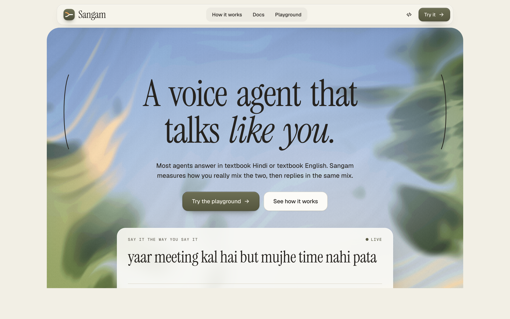
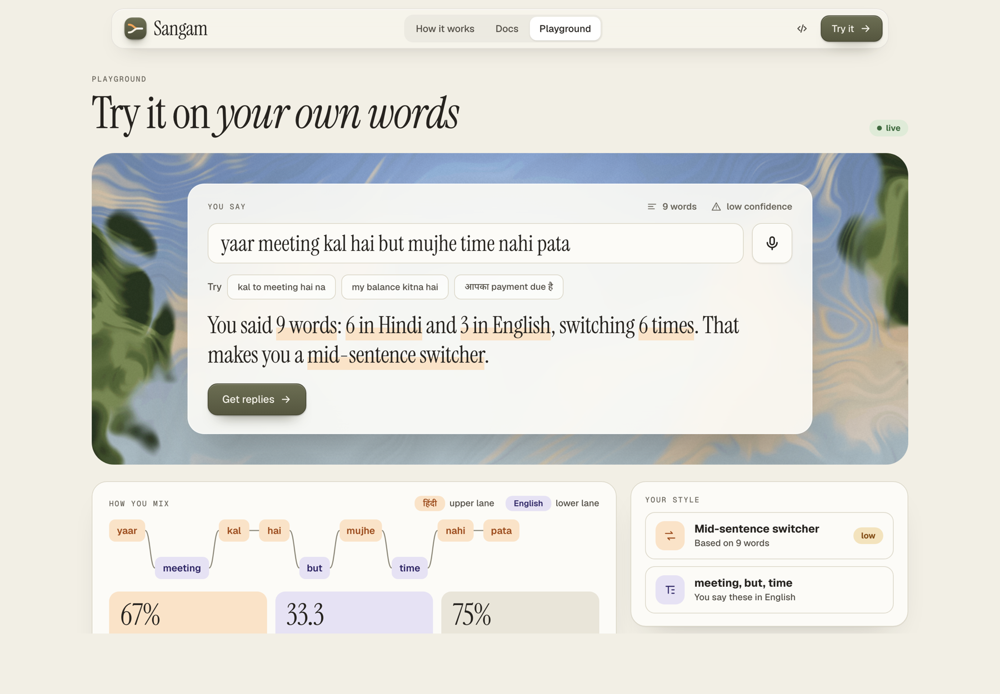
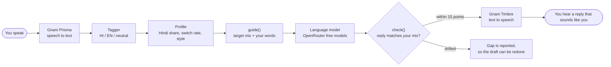
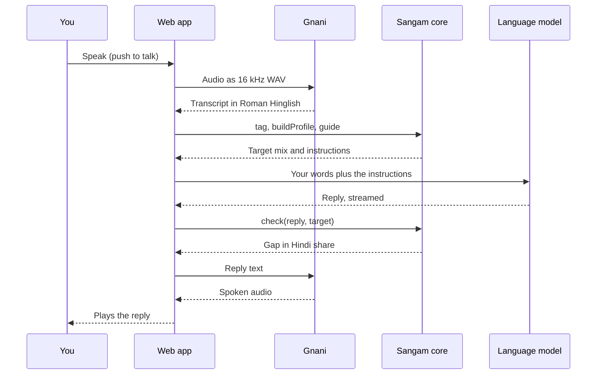

<div align="center">

# Sangam

**A voice agent that talks like you.**

Sangam measures how a person mixes Hindi and English, then keeps an agent's replies in the same mix.
Built on Gnani's Prisma speech recognition and Timbre voice for the Great Indian AI Internship Challenge.

[**Live demo**](https://sangam-voice.vercel.app) · [Playground](https://sangam-voice.vercel.app/playground) · [Docs](https://sangam-voice.vercel.app/docs) · [Results](https://sangam-voice.vercel.app/results)



</div>

## The problem

People in India rarely speak one language. A sentence like _"yaar meeting kal hai but mujhe time nahi pata"_ is normal, and it is neither Hindi nor English. Most voice agents answer in textbook Hindi or textbook English, so the reply sounds like a stranger. Sangam is a small layer that sits between speech recognition and the language model and fixes that.

## What it does

1. **Tags every word** as Hindi, English or neutral (names, numbers, fillers), in Roman or Devanagari script.
2. **Builds a profile** of how you speak: Hindi share, how often you switch language, and a style label such as "mid-sentence switcher". Recent sentences count more than old ones.
3. **Guides the model** with a target mix and a few of your own words to reuse. With too little to go on (under 20 words) it falls back to a balanced mix and says so.
4. **Checks the reply** against your mix and reports the gap. When a draft drifts it also says which way and how to fix it (`advice`), ready to paste into the next prompt.
5. **Speaks the reply** with a Gnani voice, and listens with Gnani speech recognition.



## How it works



One turn of a call, step by step:



The mix is measured with plain, deterministic maths, not a model: Hindi share, the Code-Mixing Index (Das and Gambäck, 2014) and the switch rate. That keeps the profile explainable and testable.

| Piece  | Where                                | What it does                                                                                                        |
| ------ | ------------------------------------ | ------------------------------------------------------------------------------------------------------------------- |
| Core   | [`packages/core`](packages/core)     | Tokenizer, tagger, metrics, profile, `guide()` and `check()`. No network.                                           |
| LLM    | [`packages/llm`](packages/llm)       | OpenRouter free models with a fallback chain, an optional Claude provider, a scripted mock, and the agent personas. |
| Speech | [`packages/speech`](packages/speech) | Gnani Prisma v3.0 (`codemix`) for listening and Timbre v3.0 (Shivani) for speaking.                                 |
| Eval   | [`packages/eval`](packages/eval)     | Tagger accuracy, ablations, annotator agreement and mirror fidelity.                                                |
| Web    | [`apps/web`](apps/web)               | The site, the playground, the share card and the public API.                                                        |

## Use the API

```bash
curl -s -X POST https://sangam-voice.vercel.app/api/v1/profile \
  -H "content-type: application/json" \
  -d '{"utterances": ["yaar meeting kal hai but mujhe time nahi pata"]}'
```

There are three endpoints, `profile`, `guide` and `check`. They are stateless and keep no data. See [docs/API.md](docs/API.md).

Or use the typed client in [`packages/sdk`](packages/sdk):

```ts
import { Sangam } from "@sangam/sdk";

const sangam = new Sangam({ baseUrl: "https://sangam-voice.vercel.app" });

const { profile } = await sangam.profile(["yaar meeting kal hai but mujhe time nahi pata"]);
const guidance = await sangam.guide({ profile }); // put guidance.promptFragment in your model's prompt
const result = await sangam.check(reply, guidance.target);
if (result.advice) {
  // the draft drifted: add result.advice to the prompt and ask for a closer rewrite
}
```

## Results

Measured honestly, on synthetic data. The live page is [/results](https://sangam-voice.vercel.app/results) and the full write-up, including what is weak, is in [docs/RESULTS.md](docs/RESULTS.md).

| What                                                                                                    | Result                                                                                                                                                              |
| ------------------------------------------------------------------------------------------------------- | ------------------------------------------------------------------------------------------------------------------------------------------------------------------- |
| Tagger accuracy, **held-out** set (69 utterances, 398 tokens, written after the word list was extended) | **96.7%**                                                                                                                                                           |
| Same set, with the neighbour rules switched off                                                         | 96.2%                                                                                                                                                               |
| Same set, ignoring unknown words                                                                        | 84.9%                                                                                                                                                               |
| Tagger accuracy, development set (123 utterances)                                                       | 98.9%, but this set was used to extend the word list, so it is **not evidence**                                                                                     |
| Speech: Gnani Timbre text to audio, median of 10 clips                                                  | **0.83 s** (slowest 1.35 s). Prisma audio to text: 0.27 s. The Hindi share survived the round trip to within 1.8 points on average. Synthetic speech, from a laptop |
| Mirror fidelity (do replies match the speaker's mix better than Hindi-only or English-only?)            | **Not finished.** 19 of 45 replies saved before the free model quota ran out. The script is resumable: `pnpm eval:mirror`                                           |

Things to know before trusting these numbers:

- The labelled sets were written by an AI, not recorded from people, and there is no second human annotator. Real speech will score lower.
- Every tagger error on the held-out set is a Hindi word missing from the hand-written word list.
- The microphone path has only been tested with generated audio so far.
- No human has yet rated whether the replies feel more natural. That is the next experiment.

## Run it yourself

You need Node 22 or newer and pnpm 9.

```bash
pnpm install
cp .env.example .env      # then add your own keys
pnpm dev                  # http://localhost:3000
```

It works with no keys, in a scripted mock mode. To use real models set `SANGAM_MODE=live` and add `OPENROUTER_API_KEY` for replies and `GNANI_API_KEY` for speech. Keys live in `.env` only, which git ignores. Never commit or paste them.

```bash
pnpm test                                      # unit tests
pnpm typecheck && pnpm lint
pnpm eval:tagger data/eval/tagger.heldout.jsonl  # tagger accuracy
pnpm eval:speech                               # Gnani speed and round trip (uses a little credit)
pnpm eval:mirror                               # mirror fidelity (uses free model quota)
```

To deploy, follow [docs/DEPLOY.md](docs/DEPLOY.md).

## Limits and spend guards

Replies use only free OpenRouter models, and every speech and reply call is capped (speech seconds per day and per visitor, requests per minute, a daily reply cap), with a clear message when a cap is hit. The counters live in memory inside one server process, so on a host with several instances the real total can be higher than the cap. See [docs/ARCHITECTURE.md](docs/ARCHITECTURE.md).

Other known limits: very short sentences get a balanced reply because there is too little to measure; the agent personas only change live replies (the mock stays payment themed); there are no accounts or billing, because this is a project and not yet a product.

## More

| Doc                                          | What it covers                                |
| -------------------------------------------- | --------------------------------------------- |
| [docs/RESULTS.md](docs/RESULTS.md)           | Evaluation results and their limits           |
| [docs/EVAL.md](docs/EVAL.md)                 | Evaluation plan and honesty rules             |
| [docs/ARCHITECTURE.md](docs/ARCHITECTURE.md) | Layout, data flow, tagger and metrics, guards |
| [docs/API.md](docs/API.md)                   | The public API                                |
| [docs/GNANI_NOTES.md](docs/GNANI_NOTES.md)   | What was verified about Gnani's APIs          |
| [docs/DEPLOY.md](docs/DEPLOY.md)             | Deploying to Vercel                           |
| [docs/BRAND.md](docs/BRAND.md)               | Name, voice and visual guide                  |

## Prior work

Accommodation in code-switched human-machine dialogue: Parekh et al., "Understanding Linguistic Accommodation in Code-Switched Human-Machine Dialogues", CoNLL 2020. Code-Mixing Index: Das and Gambäck (2014).

## Data

Synthetic data only. No recorded calls, no real names, no stored audio.

## License

[MIT](LICENSE)
